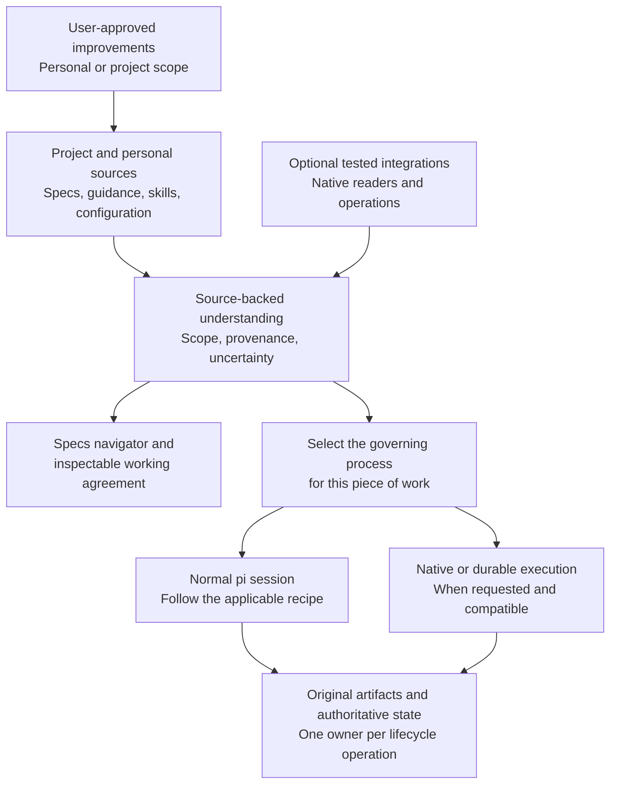
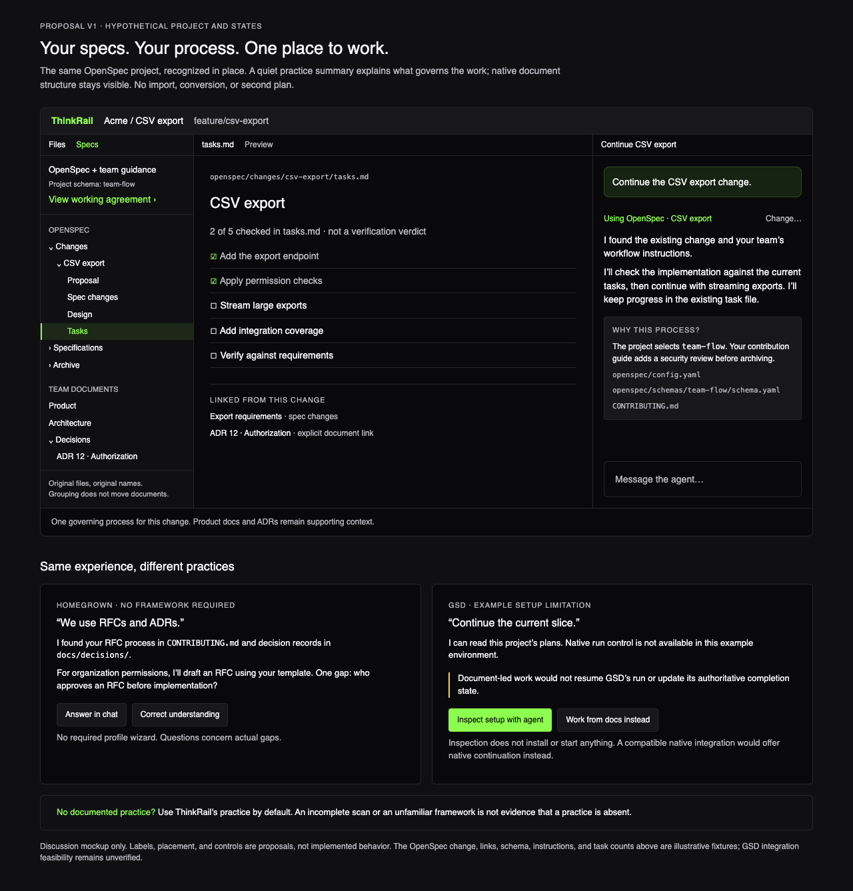
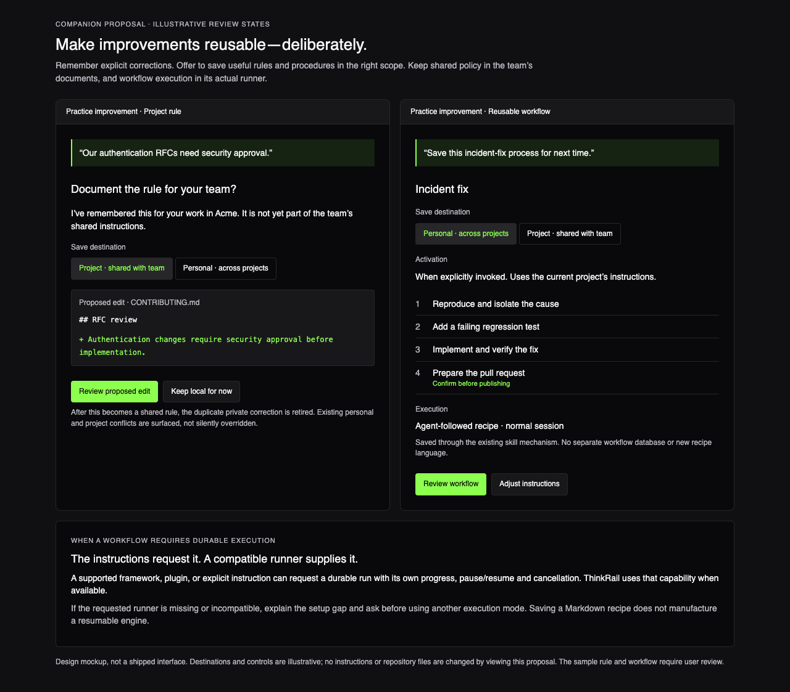

# Proposal: project-native spec-driven development

**Status: Draft for team review. Not implemented.**

**Audience:** ThinkRail product and engineering contributors.  
**Review goal:** agree on the product direction and ownership boundaries, identify missing use cases,
and choose the first delivery scope. API names, storage formats, and final UI are not being approved here.

This is a proposed direction developed through an initial product discussion, not a record of team
approval. It does not replace the current [product goals](../../goal-and-requirements.md),
[architecture](../../architecture.md), or module specifications. Those remain authoritative until an
approved implementation changes them.

**Quick review:** [summary](#1-summary-and-decisions-requested) →
[user scenarios](#3-user-scenarios) → [proposed design](#4-proposed-design) →
[open questions](#9-risks-and-open-review-questions).

## 1. Summary and decisions requested

> ThinkRail should understand the project's way of working with specs, help execute it, and help users
> improve it—without requiring a ThinkRail-specific document format.

Start with a **document-native foundation**: use the project's existing documents and instructions in
place. Add tested framework integrations for richer understanding and native operations. A project
must not need an integration, a migration, or a new manifest before its own practice becomes useful.

A **practice** is how a project works with its knowledge and work artifacts: where they live, which
instructions apply, what needs approval, and how work progresses. It may be a named framework, a
team's homegrown process, or a combination of complementary conventions.

The proposal asks the team to endorse these choices:

- **Adapt before imposing.** Follow an existing project practice instead of layering ThinkRail's
  mandatory brainstorming and task-spec lifecycle over it.
- **Keep an opinionated default.** When a successful inspection finds no documented practice, use
  ThinkRail's own practice. An unfamiliar framework or failed inspection is not absence.
- **Preserve native authority.** Keep documents and framework state in their original systems, with
  one owner for each kind of progress and lifecycle operation.
- **Support improvement, not just recognition.** Help users save rules and workflows in personal or
  project scopes, and customize frameworks through their native mechanisms.
- **Grow into full integrations.** Define full support as a tested spec/workflow lifecycle for declared
  framework versions—not parity with every feature of a standalone IDE or application.

## 2. Why change the current model?

Today, ThinkRail combines three concerns:

1. **Knowledge:** product intent, architecture, decisions, and constraints.
2. **Work artifacts:** proposals, feature specifications, task lists, and implementation records.
3. **Method:** how work starts, what needs approval, and what happens when it finishes.

Its spec index recognizes Markdown with `id` and `type` frontmatter. The authoring tools prescribe a
small type vocabulary, and the parent hierarchy primarily describes the code structure. Some other
assistants' directories, including `.gsd`, are explicitly excluded. The same index drives the Specs
navigator and the onboarding judgment that a project has specs.

Separately, bundled workflow instructions require ThinkRail's own task-spec and durable-spec
lifecycle. Consequently, adding readers for more files would not be enough: an agent could discover
OpenSpec documents and still insist on using ThinkRail's process.

The existing model is valuable for projects that want it. The problem is treating it as a prerequisite
for every project. A well-documented repository can look unconfigured, and its users can be asked to
maintain a second process or duplicate records.

The current contracts live in [spec-graph](../../packages/spec-graph/SPEC.md),
[workflow skills](../../packages/pi-thinkrail-workflow/skills/SPEC.md), and
[spec viewer reads](../../packages/server/src/spec/SPEC.md).

## 3. User scenarios

These are illustrative scenarios, not claims of current integration support.

### A team's own RFC and ADR process

The team has product documentation, a directory of requests for comments (RFCs), architectural
decision records (ADRs), and contribution guidance requiring an RFC for significant changes.

The user asks: **“Add organization-level permissions.”**

ThinkRail finds relevant constraints, explains that the team's RFC process applies, and helps draft
an RFC using its existing template. If the instructions do not establish who approves it, ThinkRail
asks that specific question. It does not demand a complete practice profile or create a parallel
ThinkRail task-spec.

### An existing OpenSpec change

The user asks: **“Continue the CSV export change.”**

ThinkRail finds the existing change, its selected schema, project-specific instructions, and current
artifacts. It continues that work rather than generating another plan. Where supported, it uses
OpenSpec's native validation and lifecycle operations.

Recognizing the framework name is not sufficient: OpenSpec allows custom artifact schemas, and an
existing change can retain a different schema from the project's current default.

### A feature started in Kiro

Requirements, design, and tasks already exist. The user asks: **“Continue this feature.”**

ThinkRail reads the applicable specs and steering guidance, establishes where work stopped, and
continues using the same artifacts. It preserves the files so work can move between tools. A design
file's existence does not prove approval; an unavailable approval or progress signal requires evidence
or a question, not a guess.

### A repository combining practices

OpenSpec governs changes, ADRs record decisions, and ordinary Markdown describes the product. All
three can inform one task without competing to run it. An obsolete Kiro directory does not activate a
second process merely because it exists.

If different parts of a larger request genuinely use different processes, split the work into scoped
units or ask the user. Do not invent a blended workflow.

### A framework that owns execution

The user asks: **“Continue the current GSD slice.”**

Reading a slice plan and implementing its next task is not necessarily the same as resuming GSD's
native workflow. The researched GSD Pi snapshot uses an authoritative database for workflow state;
some Markdown files are projections. Editing a checkbox cannot manufacture native completion.

ThinkRail should prefer compatible native continuation, explain missing setup requirements, and offer
explicitly document-led assistance when native control is unavailable. It must not present the latter
as resuming a native run. GSD Pi embedding compatibility remains unproven.

## 4. Proposed design

### Separate artifacts, guidance, and operations

A practice has three concerns:

- **Artifacts:** documents or native records, their identities, locations, types, lifecycle states,
  and relationships. A work item may span several files or live in a framework database.
- **Guidance:** project and personal instructions, framework skills, templates, and approval rules,
  with their applicable scope and source.
- **Operations:** ordinary document editing and optional native capabilities such as validation,
  archiving, or continuing a run.

A framework contributes conventions; project customization and the active piece of work determine
which conventions actually apply. Installing a validation CLI is not the same as integrating an
agent execution engine.

These are responsibilities, not a prescription for six new services. The host supplies factual reads
and capability availability; the agent interprets applicable instructions through pi's existing
skills/context mechanisms. Integrations own framework-specific semantics. The UI presents those
results rather than defining another workflow engine.

### Preserve structure without a mandatory taxonomy

Keep the useful distinctions, but do not collapse them into one required type hierarchy:

- **Purpose:** product, requirements, architecture, decision.
- **Role:** maintained reference, working proposal, process guidance.
- **Lifecycle:** draft, accepted, superseded, archived, or a native-specific state.
- **Authority:** original editable source or generated projection.

An accepted ADR can be architectural and historical. A design document for a proposed change does not
necessarily describe the system as it exists today. Finishing a task does not imply deleting all its
artifacts.

Preserve native labels and identities; do not insert frontmatter to make documents eligible. The graph
becomes a derived view of source-backed relationships, not the format a project must adopt. Distinguish
explicit links from inferred associations, and leave unknown information unknown. Basic file navigation
must remain useful without complete semantic classification.

### Discover without activating

Opening a project may perform bounded, passive discovery of document locations, markers, configuration,
and instruction sources. It must not execute repository code, install tools, start a framework, or
launch an unrequested model analysis of the whole project.

Generic interpretation happens during requested work or explicit orientation. Maintained integrations
can provide richer deterministic navigation. Until interpretation is available, show candidate documents
without claiming that the project is empty or its process is known.

Discovery must distinguish:

- No documented practice found after a successful scoped inspection.
- Partial or ambiguous evidence.
- Inspection failure or inaccessible sources.
- Stale understanding.
- A known practice with an unavailable native operation.

Only the first selects ThinkRail's fallback practice. Detection is not activation, and neither is a
trust grant. Existing project-resource trust, permissions, and file-access boundaries still apply.

### Resolve per workspace and piece of work

Use the active worktree's sources, not a project-wide interpretation copied from another branch.
Remember source references and revisions, applicable scope, explicit user choices, and uncertainty.
Revalidate affected findings when their sources change rather than rereading the entire repository on
every turn. Surface meaningful process changes at a safe checkpoint, not as a silent mid-run switch.

There are three distinct forms of remembered information:

1. **Source facts:** what current documents, configuration, or native state report.
2. **Inferred understanding:** a disposable interpretation, with provenance and uncertainty.
3. **Explicit user corrections:** durable, scoped preferences that must survive deletion of a cache.

Local customization takes precedence over generic framework conventions. Conflicting project guidance,
personal rules, or equally plausible governing processes require clarification. Old private memory
must not silently override changed team policy. Host trust and safety constraints remain in force.

### Adapt workflows and adjacent features

The workflow entry point first identifies the governing practice. ThinkRail's brainstorming,
task-spec, and spec-authoring rules apply when its practice governs—not globally to every framework.
Questioning, review, verification, and visualization remain reusable capabilities without imposing
ThinkRail's complete lifecycle.

This affects more than the Specs panel. If native tasks own the plan, do not mirror them into another
independently editable ThinkRail TODO list. Initially, linking or displaying native progress is safer
than universal two-way synchronization. “Checked in the task file” is not automatically “verified.”

Native execution can also own commits, scheduling, or worktrees. Each integration must establish one
owner for those operations rather than let both systems act independently. Recheck authoritative state
before native mutations and respect the native system's concurrency controls.

### User experience

Keep a familiar Specs navigator with native groups and types alongside complementary team documents.
Expose an inspectable **working agreement**: a concise view of which process applies, its sources, and
meaningful uncertainties. It is a view of ThinkRail's understanding, not another required document.

A task can explain “Using OpenSpec for this change” and let the user correct that selection. A custom
practice gets a focused question such as “Who approves this RFC?”, not a framework wizard. Limitations
are specific and actionable, not a permanent “unsupported framework” warning.

The following mockups use a hypothetical OpenSpec project. They illustrate behavior and information
placement, not final UI requirements or verified framework compatibility.

Compare with an illustration of the current model

The native files can be opened, but the spec index does not recognize them and the bundled workflow
still prescribes ThinkRail's process. This is an illustration of current contracts, not a captured
agent run or product screenshot.

## 5. Saving rules and adapting workflows

ThinkRail should help a practice improve through deliberate, reviewable changes. Support both personal
cross-project reuse and shared project scope, with the destination and activation conditions explicit.

### Save a rule

**“Our authentication RFCs need security approval.”**

Remember the explicit correction for the user's project and identify its origin. Offer a reviewed edit
to the team's existing guidance. If the rule becomes documented there, retire the redundant private
copy rather than maintaining two authorities. Saving it across projects requires choosing personal
scope; it must not leak there automatically.

### Customize an existing workflow

**“Add a threat-model step before implementing our OpenSpec changes.”**

Use the framework's native schemas, templates, configuration, or instructions when they support the
variation. For a homegrown process, edit its existing guide. Do not maintain a hidden ThinkRail fork of
the native workflow. Surface a customization's compatibility limits instead of silently bypassing them.

### Save a reusable procedure

**“Save how we handled this incident: reproduce, isolate the cause, add a regression test, fix, verify,
and prepare a PR.”**

Distill the useful procedure into a skill or recipe, not a transcript. Make its trigger, inputs,
approval gates, outputs, and verification clear. Reuse existing guidance rather than copying it into
another policy document. Use existing skill discovery and trust mechanisms, not a new mandatory recipe
language.

A saved workflow normally runs through a regular pi agent session. A supported framework, plugin,
explicit user request, or applicable instructions may instead call for a durable run with its own
stages, pause/resume, cancellation, and progress. Instructions can request that mode; they cannot
supply a missing runner or grant permission to execute it. If the runner is unavailable, explain the
gap and ask before switching execution modes.

Do not promote inferred habits into policy silently. Shared edits, workflow saves, and capability
installation are visible user-approved actions.

These illustrative review states show the proposed scope and consent boundaries, not shipped controls:

## 6. Framework support and compatibility boundaries

Support should answer three separate questions: can ThinkRail understand the artifacts, follow the
instructions, and perform the required native operations?

An unknown framework still receives document-led assistance. A maintained integration adds tested
knowledge and capabilities. **Full support** means the relevant native spec/workflow lifecycle works
for declared versions and schema/customization boundaries. It does not mean reproducing every feature
of Kiro's IDE, GSD's standalone environment, or another framework's surrounding product.

A maintained integration must cover the applicable operations:

- Discover the practice and identify its version, layout, and per-work-item schema.
- Navigate native artifacts and select scoped instructions and context.
- Start, continue, implement, validate, finish/archive, and customize work while preserving approvals.
- Read authoritative state and handle externally changed documents or progress.
- Explain prerequisites and limitations; preserve trust and permissions.
- Define cancellation/resume, commit, workspace, and scheduling ownership when it provides execution.

A recognized framework name is not a promise that every upstream version or customization works. A
missing installation prerequisite differs from an unsupported operation. An integration cannot claim
full support while silently substituting document-led work for a native operation in its promise.

ThinkRail remains a host for its existing in-process pi engine. Compatibility requires more than sharing
pi ancestry: a GSD integration must prove its interaction, persistence, resume, and ownership contracts.
An integration requiring a second agent runtime is outside this proposal unless that architectural
decision is explicitly revisited. Document support does not depend on solving native embedding first.

**Not required by the foundation:** a universal workflow language, a new orchestrator, a runtime plugin
marketplace, a compulsory practice manifest, or universal task synchronization. Durable execution can
be provided by a compatible capability without becoming mandatory for ordinary recipes.

## 7. Alternatives and trade-offs

**Agent-only interpretation.** Reading live instructions per task provides broad coverage with almost
no adoption burden. Used alone, it risks repeated discovery, inconsistent interpretation across chats,
and UI claims based on model guesses. The proposed foundation adds source-backed understanding and
factual navigation while keeping interpretation non-authoritative.

**Descriptor-first configuration.** A shared practice descriptor can make scopes, locations, and
instruction sources reproducible. Making it mandatory introduces another framework to maintain and
risks duplicating native configuration. Explicit mappings may be a useful escape hatch for unusual
layouts, but they are not the entrance requirement.

**Integration-first platform.** Providers that own all discovery, guidance, and operations can preserve
native semantics well. Making them the foundation creates a support cliff for homegrown or unfamiliar
practices. The proposal takes their ownership of native operations without making installation a
prerequisite for useful assistance.

The chosen trade-off is broad document-led usefulness first, with deeper fidelity where integrations
have been verified. It is not a claim that arbitrary prose can reliably expose every framework's
hidden runtime state.

## 8. Proposed delivery and validation

The ordering below is a recommendation, not an implementation authorization or a committed framework
priority.

1. **Document-native foundation.** Prove that a homegrown RFC/ADR process and ThinkRail's default work
   side by side. Broaden discovery/navigation, route to applicable guidance, and expose sources and
   uncertainty without converting files.
2. **Save and evolve practices.** Add scoped correction memory, personal/project workflow saving,
   reviewed native customizations, and conflict handling using existing skills and trust.
3. **One complete document-centered integration.** OpenSpec is the recommended first candidate:
   custom schemas and the change lifecycle exercise more than filename recognition. Run a separate
   GSD Pi compatibility spike early to test runtime ownership, not as a blocker for generic assistance.
4. **Expand tested integrations.** Prioritize Kiro, BMAD, GSD, or others from user demand. Add native
   task projections and durable-run capabilities where actual integrations require them.

An implementation should demonstrate these outcomes:

- Opening a supported or homegrown project does not rewrite its documents or activate its tools.
- An existing native change continues without a second ThinkRail task-spec or competing plan.
- Missing approval evidence produces a question; file existence is not treated as approval.
- Mixed knowledge sources remain available without activating obsolete or conflicting processes.
- Failed or partial discovery does not become a “no specs” verdict.
- Branch changes and external edits invalidate affected findings; stale state cannot authorize writes.
- Personal and project rules retain their scope; shared promotion removes redundant private rules.
- A requested native/durable run uses a verified capability or explains the gap before changing modes.

Use disposable project fixtures for discovery, source preservation, routing, and scope rules; focused
agent scenarios for following unfamiliar instructions; and integration-specific checks against actual
supported versions for native lifecycle behavior. Fixture readers alone cannot prove native execution.

## 9. Risks and open review questions

The main risks are **stale interpretations**, **hidden or conflicting private policy**, **mistaking
inferred progress for native state**, and **framework version drift**. Provenance, invalidation,
explicit scope, one lifecycle owner, and versioned conformance checks are the proposed safeguards—not
proof that those risks are already solved.

Before implementation, the team should resolve:

1. **Initial scope:** is the foundation plus custom RFC/ADR support enough for the first release, or
   must it include an end-to-end named integration?
2. **Support priorities:** should OpenSpec lead, and what versions/customizations form its first
   compatibility promise? Which native GSD operations should the feasibility spike prove?
3. **Persistence and inspection:** where do explicit corrections and reusable workflows live, and
   how do users inspect, edit, remove, and share them without confusing them with inferred caches?
4. **Context conflicts:** how should we present competing personal/project rules and guidance changes
   during ongoing work without asking repetitive questions or silently changing process?
5. **Task and execution ownership:** what must change in ThinkRail's Plan, commit, and workspace
   behavior before a native integration can safely control those operations?
6. **Presentation and extension contracts:** what is the smallest shared artifact/capability surface
   that supports native structure without flattening it? Are the proposed navigator and working-agreement
   view the right places to expose it?

Review comments should identify the user scenario, disputed behavior, and preferred alternative. The
next outcome is a bounded implementation proposal and explicit compatibility investigations—not an
assumption that every framework is already supported.

## References

Framework behavior is version-sensitive. These sources motivated the design; they are not a completed
compatibility audit or an endorsement of every claim in the linked documentation.

- **OpenSpec:** [custom schemas](https://openspec.dev/docs/customize-schemas) and the
  [default spec-driven schema](https://openspec.dev/docs/schemas/spec-driven). Artifact structure and
  dependencies can vary by project and change.
- **Kiro:** [specs](https://kiro.dev/docs/specs/) and [steering](https://kiro.dev/docs/steering/).
  Work artifacts and scoped persistent guidance are distinct concerns.
- **BMAD:** [method overview](https://docs.bmad-method.org/) and
  [project-context guidance](https://docs.bmad-method.org/existing-codebases/theory-of-project-context/).
  Planning/build skills and team practices are customizable; a brand does not define one fixed process.
- **GSD Pi:** the [current home](https://github.com/open-gsd/gsd-pi) linked from the former GSD2
  repository, and the [auto-mode contract at the researched commit](https://github.com/open-gsd/gsd-pi/blob/9eb537517d648af26a8f2c3e6b473c90d8cd4250/docs/user-docs/auto-mode.md).
  The database/projection distinction in this proposal concerns that snapshot, not every historical
  GSD2 release. Native embedding into ThinkRail has not been verified.
